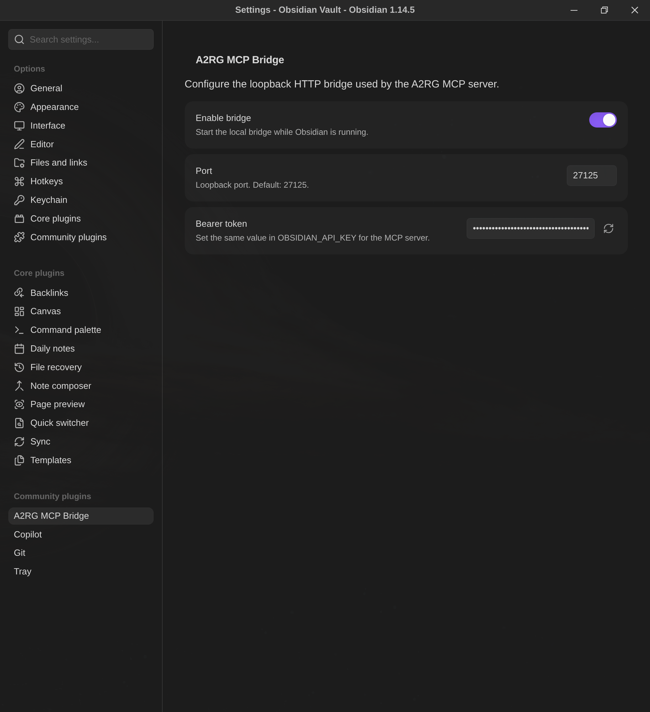

# A2RG Obsidian MCP

Hybrid Model Context Protocol (MCP) integration for Obsidian.

The project has two cooperating components:

- **A2RG MCP Bridge**, an Obsidian desktop plugin that reads and writes the
  active vault through `App.vault`, `App.metadataCache`, and `App.workspace`.
- **A2RG Obsidian MCP**, a Bun stdio server that exposes vault operations
  to MCP clients.

## Architecture

```text
MCP client
    |
    | stdio
    v
A2RG Obsidian MCP
    |
    +--> http://127.0.0.1:27125
    |         |
    |         v
    |    Obsidian plugin
    |         |
    |         v
    |    App.vault and App.workspace
    |
    +--> OBSIDIAN_VAULT_PATH
              |
              v
         Direct Markdown files
```

The plugin is the preferred active-Obsidian transport. If it is unavailable,
the MCP server falls back to direct filesystem operations.

> [!IMPORTANT]
> The bridge is local desktop infrastructure. It binds only to
> `127.0.0.1:27125` and must not be published directly to the internet.

## Quick start

Follow [Quick Start](docs/QUICKSTART.md) for the complete setup.

The shortest working setup is:

1. Build both components:

   ```bash
   npm install
   npm run build
   ```

2. Copy `manifest.json` and `main.js` into:

   ```text
   <vault>/.obsidian/plugins/a2rg-mcp-bridge/
   ```

3. Enable **A2RG MCP Bridge** in Obsidian Community Plugins.

4. Open **Settings → Community Plugins → A2RG MCP Bridge**:

   ```text
   Enable bridge: enabled
   Port: 27125
   Bearer token: generated automatically
   ```

   

5. Copy `.env.example` to `.env` and set the plugin token:

   ```bash
   cp .env.example .env
   ```

   ```dotenv
   OBSIDIAN_VAULT_PATH=/absolute/path/to/your/vault
   OBSIDIAN_API_URL=http://127.0.0.1:27125
   OBSIDIAN_API_KEY=replace-with-the-plugin-bearer-token
   OBSIDIAN_PREFER_REST=true
   OBSIDIAN_TIMEOUT_MS=3000
   ```

6. Start the MCP server:

   ```bash
   npm start
   ```

7. Register `.mcp.json` with your MCP client or use the absolute Bun
   command shown in [MCP client configuration](#mcp-client-configuration).

## Verify the setup

First verify the plugin bridge:

```bash
export OBSIDIAN_API_KEY='<paste-the-bearer-token>'
curl --fail --silent \
  -H "Authorization: Bearer ${OBSIDIAN_API_KEY}" \
  http://127.0.0.1:27125/health
```

Expected response:

```json
{"status":"ok"}
```

Then verify the MCP stdio server:

```bash
./dist/a2rg-obsidian-mcp
```

The MCP client should discover eight tools:

- `get_file`
- `write_file`
- `append_file`
- `delete_file`
- `search_vault`
- `get_linked_notes`
- `list_files`
- `get_active_file`

See [MCP tools](docs/TOOLS.md) for parameters and behavior.

## Requirements

- Obsidian Desktop 1.14.4 or later.
- Bun 1.4 or later.
- Node.js 22 or later for plugin builds.
- npm.
- A local Markdown vault.
- A desktop MCP client that supports stdio servers.

## MCP client configuration

The repository includes `.mcp.json`:

```json
{
  "mcpServers": {
    "obsidian": {
      "type": "stdio",
      "command": "/absolute/path/to/A2RG.ObsidianMCP/dist/a2rg-obsidian-mcp",
      "args": []
    }
  }
}
```

Use absolute paths for `OBSIDIAN_VAULT_PATH` and `dist/a2rg-obsidian-mcp`. Run
`npm run build` after source changes.

For Claude, Copilot, Gemini, Cursor, and VS Code, configuration file names
and fields differ. Keep the server definition equivalent: a stdio process,
the absolute entry point, and access to the `.env` or process environment.

## Plugin and MCP behavior

| Operation | Obsidian running | Obsidian closed |
|---|---|---|
| Read file | Plugin bridge | Filesystem fallback |
| Write file | Plugin bridge | Filesystem fallback |
| Append file | Plugin bridge | Filesystem fallback |
| Delete file | Plugin bridge | Filesystem fallback |
| List files | Plugin bridge | Filesystem fallback |
| Search vault | Plugin bridge | Filesystem fallback |
| Linked notes | Obsidian resolved-link graph | Empty fallback |
| Active file | Plugin bridge only | No active file |

## Documentation

- [Quick Start](docs/QUICKSTART.md)
- [Plugin Guide](docs/PLUGIN.md)
- [MCP Tools](docs/TOOLS.md)
- [Troubleshooting](docs/TROUBLESHOOTING.md)
- [Security and Public Deployment](docs/SECURITY.md)

## Development

```bash
npm run dev:mcp
npm run dev:plugin
npm test
npm run build
```

`npm run build` compiles the MCP server into a Bun executable and bundles
`main.js` for the plugin. It also type-checks plugin source code.

## Release

Plugin releases are automated by `.github/workflows/release.yml`.

1. Commit and push the source changes.
2. Update `manifest.json`, `package.json`, `package-lock.json`, and
   `versions.json` to the next release.
3. Create and push a tag matching `manifest.json.version`.
4. Publish the draft GitHub release created by the workflow.
5. Submit or update the plugin in the Obsidian community directory.

## Security boundary

- The plugin listens only on `127.0.0.1`.
- Every bridge request requires the bearer token.
- Relative vault paths are validated.
- Absolute paths and `.` / `..` path segments are rejected.
- Request bodies are capped at 5 MB.
- The plugin does not expose public HTTPS.
- The direct filesystem fallback is not a substitute for remote authentication.

Read [Security and Public Deployment](docs/SECURITY.md) before adding TLS,
reverse proxying, containers, SSH forwarding, or public network access.
