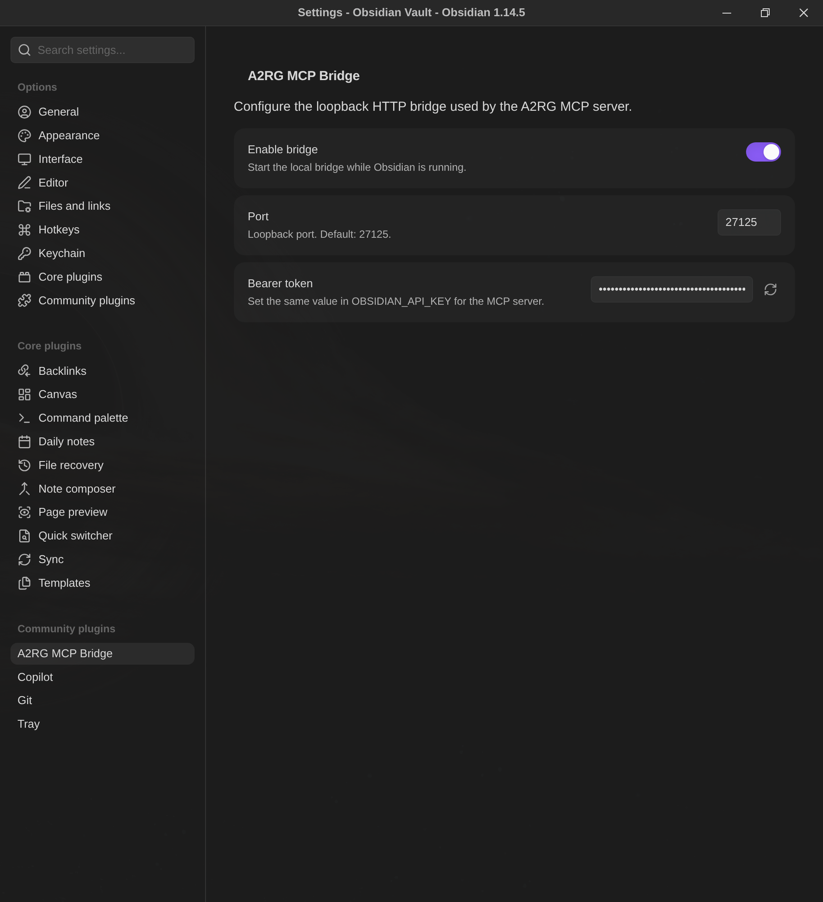

# A2RG MCP Bridge Plugin

This plugin is the active-Obsidian adapter for A2RG Obsidian MCP.

## Responsibilities

The plugin:

- Reads the active Obsidian instance through `App.vault` and `App.workspace`.
- Registers the local MCP bridge commands.
- Starts and stops an HTTP server on loopback.
- Authenticates requests with a bearer token.
- Creates missing parent folders during writes.
- Validates relative vault paths.

The MCP server is a separate Bun stdio process. The plugin does not implement
the Model Context Protocol.

## Installation

Build from the repository root:

```bash
npm install
npm run build
```

Copy `manifest.json` and `main.js` into:

```text
<vault>/.obsidian/plugins/mcp-vault-connector/
```

Restart Obsidian or reload Community Plugins, then enable
**A2RG MCP Bridge**.

The settings page shows the enable toggle, loopback port, and bearer token:



## Settings

Settings are stored in:

```text
<vault>/.obsidian/plugins/mcp-vault-connector/data.json
```

The settings file uses this shape:

```json
{
  "enabled": true,
  "port": 27125,
  "tlsEnabled": true
}
```

The bearer token and TLS private key are not stored in `data.json` or the
vault. They are stored under:

```text
~/.config/obsidian/a2rg-mcp-bridge/
~/.config/obsidian/a2rg-mcp-bridge/tls/
```

These files use private POSIX permissions when supported. Do not commit or
share `data.json`, the token file, or the TLS private key.

### Port

The plugin binds to `127.0.0.1` only. The port must be between `1` and `65535`.

Changing the port restarts the bridge. Set the matching URL in
`OBSIDIAN_API_URL` in the MCP environment.

### Bearer token

The token is a 32-byte random value encoded as 64 hexadecimal characters.
The plugin stores it in `~/.config/obsidian/a2rg-mcp-bridge/token`, and the
MCP server receives the same value through `OBSIDIAN_API_KEY`.

Rotate the token when:

- A machine or MCP configuration may have been copied.
- A user no longer needs MCP access.
- The existing token is exposed in logs or command history.
- Security credentials are being reissued as routine maintenance.

After rotation:

1. Update `OBSIDIAN_API_KEY`.
2. Restart MCP clients.
3. Confirm `/health` succeeds.
4. Remove old values from shell history and secret stores.

## Commands

The plugin registers these command-palette actions:

| Command | Purpose |
|---|---|
| Start MCP bridge | Start the loopback server. |
| Stop MCP bridge | Stop the loopback server. |
| Show MCP bridge status | Display the current running state. |

The plugin also starts or stops the bridge according to the enabled setting.

## HTTP operations

The bridge is local infrastructure, not a public API:

| Method | Path | Purpose |
|---|---|---|
| `GET` | `/health` | Check authenticated bridge availability. |
| `GET` | `/active` | Read the active Obsidian file. |
| `GET` | `/list` | List a vault directory. |
| `GET` | `/search` | Search Markdown files. |
| `GET` | `/graph` | Read resolved incoming and outgoing Obsidian graph links. |
| `POST` | `/append` | Append to a file. |
| `GET` | `/vault/<path>` | Read a vault file. |
| `PUT` | `/vault/<path>` | Create or replace a vault file. |
| `DELETE` | `/vault/<path>` | Delete a vault file. |

Send the token as:

```text
Authorization: Bearer <token>
```

The plugin returns `401` for missing or invalid credentials and `404` for
missing files.

## Development

```bash
npm run dev:plugin
npm test
npm run build
```

`esbuild.config.mjs` bundles `plugin/src/main.ts` into `main.js`.
`plugin/tsconfig.json` performs strict type checking without emitting JavaScript.

Obsidian plugin releases require:

- `manifest.json`
- `main.js`
- Optional `styles.css`
- A GitHub tag matching `manifest.json.version`
