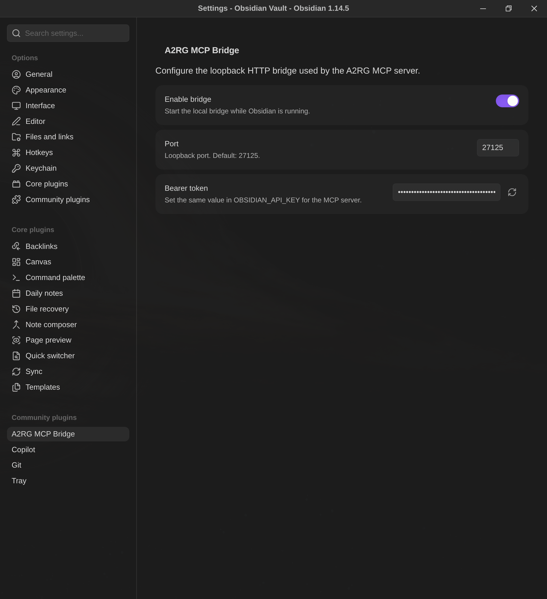

# Quick Start

This guide configures the Obsidian plugin and the MCP stdio server end to end.

## 1. Requirements

- Obsidian Desktop 1.14.4 or later.
- Bun 1.4 or later.
- Node.js 22 or later for plugin builds.
- npm.
- The absolute path to an existing Obsidian vault.
- A desktop MCP client that supports stdio servers.

Check the runtimes:

```bash
bun --version
node --version
npm --version
```

## 2. Build the project

From the repository root:

```bash
npm install
npm run build
```

This creates:

```text
dist/index.js
dist/a2rg-obsidian-mcp
main.js
manifest.json
```

## 3. Install the plugin

Create this directory if it does not exist:

```text
<vault>/.obsidian/plugins/a2rg-mcp-bridge/
```

Copy the generated files:

```text
manifest.json
main.js
```

Example copy command:

```bash
VAULT='/absolute/path/to/your/vault'
mkdir -p "$VAULT/.obsidian/plugins/a2rg-mcp-bridge"
cp manifest.json main.js "$VAULT/.obsidian/plugins/a2rg-mcp-bridge/"
```

Restart Obsidian or reload Community Plugins. Enable
**A2RG MCP Bridge** under **Settings → Community Plugins**.

## 4. Configure the plugin

Open **Settings → Community Plugins → A2RG MCP Bridge**.



Confirm:

| Setting | Recommended value |
|---|---:|
| Enable bridge | Enabled |
| Port | `27125` |
| Bearer token | Automatically generated |

The bearer token is a secret. Do not publish it in screenshots, logs, notes,
source control, or support messages.

If the token field is already filled, use its value. If it is blank, enable
the plugin and wait for it to generate the token.

Use **Generate a new token** only when rotation is intended. Updating the
token restarts the bridge.

## 5. Configure the MCP server

Create the local environment file:

```bash
cp .env.example .env
```

Set all values:

```dotenv
OBSIDIAN_VAULT_PATH=/absolute/path/to/your/vault
OBSIDIAN_API_URL=http://127.0.0.1:27125
OBSIDIAN_API_KEY=replace-with-the-plugin-bearer-token
OBSIDIAN_PREFER_REST=true
OBSIDIAN_TIMEOUT_MS=3000
```

Rules:

- `OBSIDIAN_VAULT_PATH` must be an absolute directory path.
- `OBSIDIAN_API_URL` must use the configured plugin port.
- `OBSIDIAN_API_KEY` must exactly match the plugin bearer token.
- `.env` must not be committed.

## 6. Register the MCP server

The repository includes `.mcp.json`:

```json
{
  "mcpServers": {
    "obsidian": {
      "type": "stdio",
      "command": "/absolute/path/to/A2RG.ObsidianMCP/dist/a2rg-obsidian-mcp",
      "args": []
    }
  }
}
```

Replace `/absolute/path/to/A2RG.ObsidianMCP` with the repository path on your
machine. Restart or reload the MCP client after changing configuration.

## 7. Verify the bridge

Export the token locally:

```bash
export OBSIDIAN_API_KEY='<paste-the-plugin-bearer-token>'
```

Check the health endpoint:

```bash
curl --fail --silent \
  -H "Authorization: Bearer ${OBSIDIAN_API_KEY}" \
  http://127.0.0.1:27125/health
```

Expected response:

```json
{"status":"ok"}
```

Without the header, the endpoint returns `401 Unauthorized`.

## 8. Verify the MCP server

List tools and call `list_files` through an MCP stdio client. A successful
server exposes:

```text
get_file
write_file
append_file
delete_file
search_vault
get_linked_notes
list_files
get_active_file
```

Call `list_files` with an empty directory to list the vault root.

## 9. Verify filesystem fallback

Close Obsidian.

Run `get_file` or `list_files` in the MCP client. The operation should use
`OBSIDIAN_VAULT_PATH`.

The fallback should not return active-editor state. `get_active_file` is
available only while the plugin bridge is connected.

For detailed failures, use [Troubleshooting](TROUBLESHOOTING.md).
